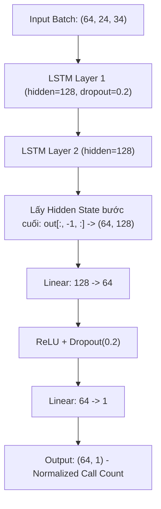

# 📑 Báo Cáo Kỹ Thuật: Quy Trình Huấn Luyện LSTM Với `seq_len = 24h`

**Dự án:** Dự báo nhu cầu xe cứu thương San Francisco (`call_count`)<br>
**Mục tiêu:** Dự báo số lượng cuộc gọi cấp cứu ở giờ tiếp theo ($t$) dựa trên chuỗi quan sát của 24 giờ trước đó ($[t-24, t-1]$).

---

## 1. Bản Chất Của Thiết Lập `seq_len = 24`

### 1.1 Ý nghĩa nghiệp vụ
- **Chu kỳ sinh học & nhịp sinh hoạt hàng ngày (Diurnal Cycle):** Nhu cầu cấp cứu biến thiên rất rõ nét theo các khung giờ trong ngày (sáng sớm vắng, tăng dần vào buổi trưa và chiều tối).
- Độ dài `seq_len = 24` giúp mô hình nắm trọn **1 chu kỳ 24 giờ gần nhất**, kết hợp cùng các đặc trưng lag/rolling đã có để dự báo giờ thứ 25.
- Kích thước này tối ưu về bộ nhớ RAM/VRAM và tốc độ huấn luyện so với các chuỗi dài hơn (như 168h).

### 1.2 Cơ chế Cửa Sổ Trượt (Sliding Window)

Giả sử dữ liệu theo chuỗi thời gian được đánh chỉ số theo giờ $0, 1, 2, \dots, T$:

```
Sample 0:  [Giờ 00 ────────────► Giờ 23] (24h input)  ──► Target: Giờ 24
Sample 1:  [Giờ 01 ────────────► Giờ 24] (24h input)  ──► Target: Giờ 25
Sample 2:  [Giờ 02 ────────────► Giờ 25] (24h input)  ──► Target: Giờ 26
...
Sample N:  [Giờ t-24 ──────────► Giờ t-1] (24h input) ──► Target: Giờ t
```

---

## 2. Kích Thước Dữ Liệu & Tensor Transformations

Dữ liệu đầu vào gồm 34 đặc trưng (`hour`, `sin/cos cyclical`, `rolling stats`, `lag features`).

| Tập dữ liệu | Số dòng gốc (CSV) | Số mẫu sau khi tạo seq ($N - 24$) | Shape Tensor Input $X$ | Shape Target $y$ |
|---|---|---|---|---|
| **Train** (2019–2024) | 52,440 | **52,416** | `(52416, 24, 34)` | `(52416, 1)` |
| **Validation** (2025) | 8,760 | **8,736** | `(8736, 24, 34)` | `(8736, 1)` |
| **Test** (2026) | 6,796 | **6,772** | `(6772, 24, 34)` | `(6772, 1)` |

> [!IMPORTANT]
> **Quy tắc chống rò rỉ dữ liệu (Data Leakage):**
> 1. `StandardScaler` (cho 34 features) và `MinMaxScaler` (cho `call_count` target về $[0, 1]$) **chỉ được `fit` trên tập Train**, sau đó dùng `transform` cho Val và Test.
> 2. Quá trình tạo sequence được thực hiện riêng rẽ trên từng tập (không trượt qua ranh giới giữa Train ➔ Val hoặc Val ➔ Test).

---

## 3. Kiến Trúc Mô Hình (Vanilla LSTM Baseline)



### Thông số chi tiết:
- **Input dimension:** 34
- **Hidden size:** 128
- **Số lớp LSTM (`num_layers`):** 2
- **Lớp kết nối đầy đủ (FC Head):** `Linear(128, 64) -> ReLU -> Dropout(0.2) -> Linear(64, 1)`
- **Tổng số tham số trainable:** ~**223,361 tham số** (nhẹ, tính toán nhanh).

---

## 4. Thiết Lập Huấn Luyện (Training Strategy)

| Tham số / Cơ chế | Cấu hình | Mục đích kỹ thuật |
|---|---|---|
| **Batch Size** | 64 | Cân bằng giữa gradient stability và tốc độ update |
| **Loss Function** | `nn.MSELoss()` | Tối ưu sai số toàn phương trên dữ liệu scaled |
| **Optimizer** | `Adam(lr=0.001, weight_decay=1e-5)` | $L_2$ regularization chống overfit |
| **Gradient Clipping** | `clip_grad_norm = 1.0` | Ngăn chặn hiện tượng nổ gradient (Exploding Gradients) thường gặp ở RNN/LSTM |
| **LR Scheduler** | `ReduceLROnPlateau(patience=5, factor=0.5)` | Tự động giảm một nửa learning rate nếu Val Loss đi ngang 5 epochs |
| **Early Stopping** | `patience=10` | Dừng training khi Val Loss không cải thiện sau 10 epochs, tự khôi phục checkpoint tốt nhất |
| **DataLoader Shuffle** | `shuffle=False` | Giữ nguyên thứ tự thời gian |

---

## 5. Quy Trình Suy Luận & Đánh Giá (Inference & Post-processing)

1. **Inference:** Dự đoán trên `test_dl` nhận kết quả scaled $y_{norm} \in [0, 1]$.
2. **Inverse Transform:** Đưa về đơn vị thực tế (số lượng cuộc gọi):
   $$\hat{y} = \text{scaler\_y.inverse\_transform}(\hat{y}_{norm})$$
3. **Physical Constraint Clipping:**
   $$\hat{y}_{final} = \max(0, \hat{y})$$
   *(Số lượt gọi xe cứu thương không thể nhận giá trị âm)*
4. **Bộ chỉ số đo lường:**
   - **MAE (Mean Absolute Error):** Sai số trung bình (đơn vị: cuộc gọi/giờ) — trực quan nhất cho điều phối xe.
   - **RMSE (Root Mean Squared Error):** Phạt nặng các giờ có đỉnh điểm quá tải (spikes).
   - **MAPE (%):** Phần trăm sai số tương đối.
   - **$R^2$ Score:** Khả năng giải thích phương sai của mô hình.

---

## 6. Hướng Dẫn Thực Thi

### Cách 1: Chạy trực tiếp qua Code Python
```python
from ems.models.lstm.preprocess import build_dataloaders
from ems.models.lstm.model import build_model
from ems.models.lstm.train import train
from ems.models.lstm.evaluate import evaluate_all

# 1. Tạo DataLoaders cho seq_len=24
train_dl, val_dl, test_dl, feat_scaler, tgt_scaler = build_dataloaders(seq_len=24, batch_size=64)

# 2. Khởi tạo mô hình
model = build_model("vanilla", n_features=34, hidden_size=128, num_layers=2)

# 3. Huấn luyện
history = train(model, train_dl, val_dl, run_name="vanilla_seq24", num_epochs=100)

# 4. Đánh giá & Xuất biểu đồ
y_true, y_pred, metrics = evaluate_all(model, test_dl, tgt_scaler, "vanilla_seq24", history)
```

### Cách 2: Chạy qua Notebook tương tác
Mở file [notebooks/lstm_experiment.ipynb](../notebooks/lstm_experiment.ipynb) và thực thi từ **Cell 1 đến Cell 4**. File sẽ tự động lưu weights tại `checkpoints/lstm/vanilla_seq24_best.pth` và biểu đồ trực quan tại `outputs/lstm/`.
